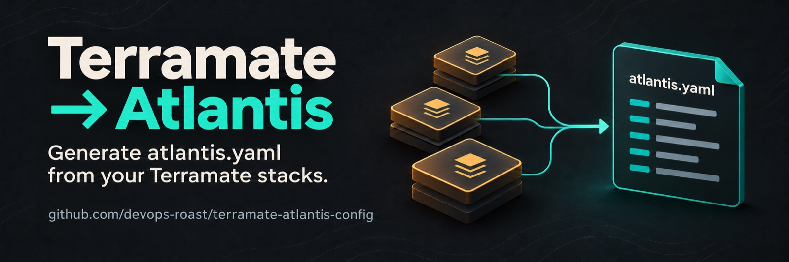
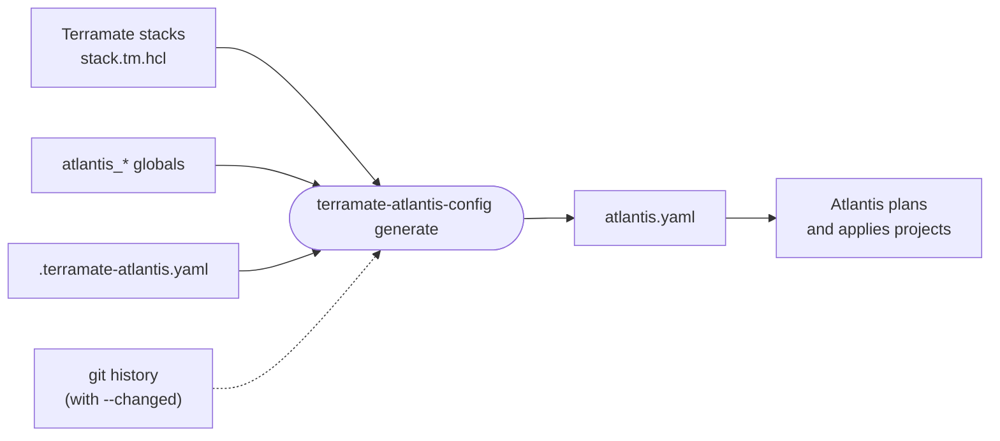

<div align="center">



[](https://github.com/devops-roast/terramate-atlantis-config/actions) [](https://github.com/devops-roast/terramate-atlantis-config/releases) [](https://goreportcard.com/report/github.com/devops-roast/terramate-atlantis-config)

[What it does](#what-it-does) · [Install](#install) · [Quickstart](#quickstart) · [Documentation](#documentation) · [FAQ](docs/faq.md)

</div>

## What it does

You keep your infrastructure in [Terramate](https://terramate.io) [stacks](https://terramate.io/docs/cli/stacks/) and run it through [Atlantis](https://www.runatlantis.io). Atlantis needs an [`atlantis.yaml`](https://www.runatlantis.io/docs/repo-level-atlantis-yaml.html) that lists every project. This tool writes that file for you: one project per stack, kept in step as you add, rename and remove stacks.

It reads stack definitions, globals and, with `--changed`, git history. It doesn't run Terraform and doesn't change your stack files.



<p align="center"><sub><b>Figure 1.</b> Inputs the tool reads and the file it writes.</sub></p>

For example, [`testdata/multi`](testdata/multi) has three stacks. `terramate-atlantis-config generate` turns them into three projects:

<table>
<tr>
<th>Terramate stacks</th>
<th><code>atlantis.yaml</code></th>
</tr>
<tr>
<td valign="top">

```text
.
├── terramate.tm.hcl
├── apps/web/stack.tm.hcl
└── infra/
    ├── rds/stack.tm.hcl
    └── vpc/stack.tm.hcl
```

```hcl
# infra/vpc/stack.tm.hcl
stack {
  name = "vpc"
  id   = "a1b2c3d4-0000-0000-0000-000000000001"
}
```

</td>
<td valign="top">

```yaml
# Generated by terramate-atlantis-config. DO NOT EDIT.
# Re-generate with: terramate-atlantis-config generate
version: 3
automerge: false
parallel_plan: true
parallel_apply: true
projects:
  - name: apps-web
    dir: apps/web
    autoplan:
      enabled: true
      when_modified:
        - '*.tf'
        - '*.tf.json'
        - .terraform.lock.hcl
  - name: infra-rds
    dir: infra/rds
    autoplan:
      enabled: true
      when_modified:
        - '*.tf'
        - '*.tf.json'
        - .terraform.lock.hcl
  - name: infra-vpc
    dir: infra/vpc
    autoplan:
      enabled: true
      when_modified:
        - '*.tf'
        - '*.tf.json'
        - .terraform.lock.hcl
```

</td>
</tr>
</table>

<p align="center"><sub><b>Figure 2.</b> A repository with three stacks and the file the tool generates for it.</sub></p>

Beyond the project list, the tool maps more Terramate concepts to Atlantis settings:

| In Terramate                             | In `atlantis.yaml`                                                    | Read more                                |
| ---------------------------------------- | --------------------------------------------------------------------- | ---------------------------------------- |
| a stack                                  | a project with a `dir` and a `name`                                   | [Project naming](docs/project-naming.md) |
| `atlantis_*` globals                     | per-project workflow, autoplan, apply requirements, Terraform version | [Stack globals](docs/stack-globals.md)   |
| tags, paths, git changes                 | which projects are included                                           | [Filtering](docs/filtering.md)           |
| stack `after` / `before`                 | `depends_on` and `execution_order_group`                              | [Dependencies](docs/dependencies.md)     |
| `terramate run`                          | a generated `terramate` workflow                                      | [Workflows](docs/workflows.md)           |
| parent config, imports, modules, `watch` | `autoplan.when_modified`, with `--when-modified-from-config`          | [Autoplan](docs/autoplan.md)             |

<p align="center"><sub><b>Table 1.</b> How Terramate concepts become Atlantis settings.</sub></p>

## Install

| Method                  | Command                                                                                                                                |
| ----------------------- | -------------------------------------------------------------------------------------------------------------------------------------- |
| Homebrew                | `brew install --cask devops-roast/tap/terramate-atlantis-config`                                                                       |
| Go 1.25.5 or later      | `go install github.com/devops-roast/terramate-atlantis-config@latest`                                                                  |
| Archive, `.deb`, `.rpm` | Download from [GitHub Releases](https://github.com/devops-roast/terramate-atlantis-config/releases) and put the binary on your `PATH` |
| From source             | See [CONTRIBUTING.md](CONTRIBUTING.md#development-setup)                                                                               |

<p align="center"><sub><b>Table 2.</b> Ways to install the tool.</sub></p>

You need `git`, a Terramate repository with at least one stack, and an [Atlantis server](https://www.runatlantis.io/docs/installation-guide.html). The tool reads stacks through the Terramate SDK, so the `terramate` CLI is only needed on the Atlantis server, and only for [generated workflows](docs/workflows.md).

## Quickstart

From the root of your repository:

```sh
terramate-atlantis-config generate --output atlantis.yaml
```

Then choose where the file is generated:

|                        | A. Commit the file                         | B. Generate on the Atlantis server                         |
| ---------------------- | ------------------------------------------ | ---------------------------------------------------------- |
| Who runs the tool      | you, the pre-commit hook and CI            | Atlantis, in a pre-workflow hook                           |
| `atlantis.yaml` in git | yes, reviewed in every pull request        | no                                                         |
| Where you install it   | your machine and CI                        | your Atlantis image                                        |
| Pick it when           | you want to review every change to the file | you don't want a generated file in git                    |
| Full guide             | [Setup A](docs/setup.md#a-commit-the-file) | [Setup B](docs/setup.md#b-generate-on-the-atlantis-server) |

<p align="center"><sub><b>Table 3.</b> The two ways to run the tool.</sub></p>

**A. Commit the file.** Regenerate it on every commit with the [pre-commit](https://pre-commit.com) hook, and fail CI when it's stale with the GitHub Action:

```yaml
# .pre-commit-config.yaml
repos:
  - repo: https://github.com/devops-roast/terramate-atlantis-config
    rev: v1
    hooks:
      - id: terramate-atlantis-config
```

```yaml
# GitHub Actions job step
- uses: devops-roast/terramate-atlantis-config@v1
  with:
    check: "true"
```

**B. Generate on the Atlantis server.** Atlantis runs the tool as a [pre-workflow hook](https://www.runatlantis.io/docs/pre-workflow-hooks.html) on every pull request. The binary must be in your Atlantis image:

```yaml
# Server-side repos.yaml
repos:
  - id: /.*/
    pre_workflow_hooks:
      - run: terramate-atlantis-config generate --output atlantis.yaml --root .
        description: Generate atlantis.yaml from Terramate stacks
```

> [!IMPORTANT]
> Atlantis rejects the whole `atlantis.yaml` when it sets a key that the [server-side `repos.yaml`](https://www.runatlantis.io/docs/server-side-repo-config.html) doesn't allow. If your projects set a workflow or apply requirements, or the file defines workflows, allow it on the server:
>
> ```yaml
> repos:
>   - id: /.*/
>     allowed_overrides: [workflow, apply_requirements]
>     allow_custom_workflows: true
> ```
>
> [Which option each feature needs](docs/setup.md#server-side-repo-config).

## Documentation

| Page                                       | Read this when…                                                                                 |
| ------------------------------------------ | ----------------------------------------------------------------------------------------------- |
| [Setup](docs/setup.md)                     | you wire the tool into pre-commit, GitHub Actions, another CI or Atlantis itself                |
| [Configuration](docs/configuration.md)     | you look up a flag or a `.terramate-atlantis.yaml` key                                          |
| [Stack globals](docs/stack-globals.md)     | one stack needs a different workflow, Terraform version, autoplan or skip                       |
| [Filtering](docs/filtering.md)             | you want only some stacks: by tag, by path, or changed in a pull request                        |
| [Project naming](docs/project-naming.md)   | you want shorter or different project names                                                     |
| [Dependencies](docs/dependencies.md)       | stacks must plan and apply in order                                                             |
| [Workflows](docs/workflows.md)             | Atlantis should run Terraform through `terramate run`, or you map tags to workflows             |
| [Autoplan](docs/autoplan.md)               | a change to a parent's globals, an imported file or a module should plan the stacks that use it |
| [Commands](docs/commands.md)               | you check an existing `atlantis.yaml`, or need exit codes                                       |
| [Troubleshooting](docs/troubleshooting.md) | something fails or the output isn't what you expected                                           |
| [FAQ](docs/faq.md)                         | you have a "can it…" or "why does it…" question                                                 |

<p align="center"><sub><b>Table 4.</b> Where to find each topic.</sub></p>

## Contributing

Bug reports, ideas and pull requests are welcome. See [CONTRIBUTING.md](CONTRIBUTING.md).

## License

[MIT](LICENSE)
