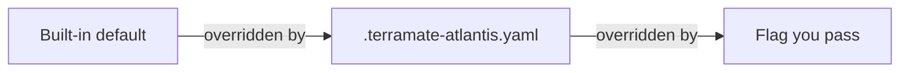

<sub>[Documentation](../README.md#documentation) › Configuration</sub>

# Configuration

You configure `terramate-atlantis-config generate` with flags, with a `.terramate-atlantis.yaml` file, or both. Flags you pass override the file.

**On this page:** [Config file](#config-file) · [Keys](#keys) · [CLI flags](#cli-flags): [Output](#output) · [Filtering](#filtering) · [Naming](#naming) · [Dependencies](#dependencies) · [Workflows](#workflows) · [CI modes](#ci-modes)

## Config file

Put `.terramate-atlantis.yaml` in the directory you pass as `--root` (the current directory by default). The tool reads it on every run, so the pre-commit hook, CI and Atlantis all use the same settings.

```yaml
output: atlantis.yaml
generate_workflows: true
autoplan: true
parallel: true
project_name_strategy: last-n
project_name_depth: 2
apply_requirements:
  - approved
  - mergeable
when_modified:
  - "*.tf"
  - "*.tf.json"
  - ".terraform.lock.hcl"
tag_workflows:
  production: prod-workflow
  staging: staging-workflow
tag_requirements:
  production: [approved, mergeable]
workflows:
  prod-workflow:
    plan:
      steps:
        - run: terramate run --no-recursive --disable-safeguards=git -- terraform init -input=false > /dev/null
        - run: terramate run --no-recursive --disable-safeguards=git -- terraform plan -input=false -out="$PLANFILE"
    apply:
      steps:
        - run: terramate run --no-recursive --disable-safeguards=git -- terraform apply "$PLANFILE"
```

<p align="center"><sub><b>Figure 1.</b> A config file that sets a value for most kinds of key.</sub></p>

Each setting comes from the most specific source that sets it:



<p align="center"><sub><b>Figure 2.</b> Precedence of settings, from lowest to highest.</sub></p>

<dl>
<dt>Location</dt>
<dd>The tool looks for <code>.terramate-atlantis.yaml</code>, then <code>.terramate-atlantis.yml</code>, in <code>--root</code>. If both exist, <code>.yaml</code> wins. Use <code>--config path/to/file.yaml</code> to read another file.</dd>
<dt>Precedence</dt>
<dd>A flag you pass explicitly overrides the file. That includes an empty value: <code>--apply-requirements=</code> or <code>--tag-requirements=</code> replaces the file's list or mappings with none.</dd>
<dt>Unknown keys</dt>
<dd>An unknown key is an error, so a typo fails loudly instead of being ignored. The error lists every valid key.</dd>
</dl>

### Keys

Every key matches a `generate` flag:

| Key                           | Type                      | Flag                            |
| ----------------------------- | ------------------------- | ------------------------------- |
| `output`                      | string                    | `--output`                      |
| `format`                      | string                    | `--format`                      |
| `no_header`                   | bool                      | `--no-header`                   |
| `log_level`                   | string                    | `--log-level`                   |
| `filter`                      | string                    | `--filter`                      |
| `filter_path`                 | string                    | `--filter-path`                 |
| `exclude_tags`                | string                    | `--exclude-tags`                |
| `exclude_path`                | string                    | `--exclude-path`                |
| `changed`                     | bool                      | `--changed`                     |
| `changed_base_ref`            | string                    | `--changed-base-ref`            |
| `create_project_name`         | bool                      | `--create-project-name`         |
| `project_name_strategy`       | string                    | `--project-name-strategy`       |
| `project_name_prefix`         | string                    | `--project-name-prefix`         |
| `project_name_depth`          | int                       | `--project-name-depth`          |
| `create_workspace`            | bool                      | `--create-workspace`            |
| `sort_by`                     | string                    | `--sort-by`                     |
| `execution_order_groups`      | bool                      | `--execution-order-groups`      |
| `depends_on`                  | bool                      | `--depends-on`                  |
| `autoplan`                    | bool                      | `--autoplan`                    |
| `parallel`                    | bool                      | `--parallel`                    |
| `automerge`                   | bool                      | `--automerge`                   |
| `workflow`                    | string                    | `--workflow`                    |
| `terraform_version`           | string                    | `--terraform-version`           |
| `when_modified`               | list(string)              | `--when-modified`               |
| `when_modified_from_config`   | bool                      | `--when-modified-from-config`   |
| `apply_requirements`          | list(string)              | `--apply-requirements`          |
| `tag_workflows`               | map(string)               | `--tag-workflow`                |
| `tag_requirements`            | map(list(string))         | `--tag-requirements`            |
| `preserve_workflows`          | bool                      | `--preserve-workflows`          |
| `generate_workflows`          | bool                      | `--generate-workflows`          |
| `workflow_terramate_wrap`     | bool                      | `--workflow-terramate-wrap`     |
| `workflow_disable_safeguards` | list(string)              | `--workflow-disable-safeguards` |
| `workflows`                   | map of Atlantis workflows | none (config file only)         |

<p align="center"><sub><b>Table 1.</b> Config file keys and the flags they match.</sub></p>

`--root`, `--config`, `--check` and `--diff` describe a single run and have no config key.

<details>
<summary><b>Edge cases</b></summary>

- `tag_requirements` values and `workflow_disable_safeguards` may also be a comma-separated string: `production: approved,mergeable`.
- A key set to null, or a string key set to `""`, is the same as leaving it out.
- An empty list is an explicit value, like passing the flag with an empty value: `when_modified: []` means no patterns. `workflow_disable_safeguards: ""` counts as an empty list too.
- `output` is relative to the current directory, not to `--root`.
- `workflows` is merged with other workflows by name. See [Workflows](workflows.md#merging-workflows).

</details>

## CLI flags

Run `terramate-atlantis-config generate --help` for the same list. Flags are grouped by topic below; each group links to the page that explains it.

### Output

| Flag          | Default | Description                                                                         |
| ------------- | ------- | ----------------------------------------------------------------------------------- |
| `--root`      | `.`     | Root directory of the Terramate project; project dirs are relative to it, so point it at the repo root Atlantis checks out |
| `--output`    | stdout  | Output file path, or `-` for stdout                                                 |
| `--format`    | `yaml`  | Output format: `yaml` or `json`                                                     |
| `--no-header` | `false` | Omit the generated-by header comment (YAML only)                                    |
| `--config`    |         | Config file path (default: `.terramate-atlantis.yaml` or `.yml` in `--root`)       |
| `--log-level` | `warn`  | Terramate SDK log level: `trace`, `debug`, `info`, `warn`, `error`, `disabled`      |

<p align="center"><sub><b>Table 2.</b> Output flags.</sub></p>

The generated config goes to stdout or the `--output` file. Logs go to stderr, so they never mix with it. `--log-level` only controls Terramate SDK messages; this tool's own warnings always print. When it writes a file, the tool reports it on stderr: `Generated atlantis.yaml with 3 projects`.

### Filtering

| Flag             | Default | Description                                                       |
| ---------------- | ------- | ----------------------------------------------------------------- |
| `--filter`       |         | Include only stacks matching this Terramate tag filter            |
| `--filter-path`  |         | Include only stacks at or under directories matching this glob    |
| `--exclude-tags` |         | Exclude stacks matching this Terramate tag filter                 |
| `--exclude-path` |         | Exclude stacks at or under directories matching this glob         |

<p align="center"><sub><b>Table 3.</b> Filtering flags. <code>--changed</code> is under <a href="#ci-modes">CI modes</a>.</sub></p>

See [Filtering](filtering.md) for tag filters, glob rules, and how filters combine.

### Naming

| Flag                      | Default      | Description                                                   |
| ------------------------- | ------------ | ------------------------------------------------------------- |
| `--create-project-name`   | `true`       | Give each project a name (see `--project-name-strategy`)      |
| `--project-name-strategy` | `auto-strip` | Naming strategy: `auto-strip`, `stack-name`, `last-n`, `full` |
| `--project-name-prefix`   |              | Strip this prefix from stack paths (`auto-strip`, `stack-name`) |
| `--project-name-depth`    | `3`          | Number of trailing path segments for `last-n` (at least 1)    |
| `--create-workspace`      | `false`      | Set workspace from stack path (made a valid Atlantis workspace; the root stack keeps the default) |
| `--sort-by`               | `dir`        | Sort projects by `dir`, `name` or `execution_order_group` (needs `--execution-order-groups`, else it sorts by dir) |

<p align="center"><sub><b>Table 4.</b> Naming flags. See <a href="project-naming.md">Project naming</a>.</sub></p>

### Dependencies

| Flag                       | Default | Description                                              |
| -------------------------- | ------- | -------------------------------------------------------- |
| `--execution-order-groups` | `false` | Set `execution_order_group` from stack ordering          |
| `--depends-on`             | `false` | Set `depends_on` (project names) from stack ordering     |

<p align="center"><sub><b>Table 5.</b> Dependency flags. See <a href="dependencies.md">Dependencies</a>.</sub></p>

### Workflows

| Flag                        | Default                                | Description                                                         |
| --------------------------- | -------------------------------------- | ------------------------------------------------------------------- |
| `--autoplan`                | `true`                                 | Default autoplan setting                                            |
| `--parallel`                | `true`                                 | Enable parallel plan and apply                                      |
| `--automerge`               | `false`                                | Enable automerge                                                    |
| `--workflow`                |                                        | Default workflow name for all projects                              |
| `--terraform-version`       |                                        | Default Terraform version for all projects                          |
| `--when-modified`           | `*.tf, *.tf.json, .terraform.lock.hcl` | File patterns that trigger autoplan                                 |
| `--when-modified-from-config` | `false`                              | Also trigger autoplan on the files each stack depends on: parent Terramate config, imports, `watch` files, local modules. See [Autoplan](autoplan.md) |
| `--apply-requirements`      |                                        | Default apply requirements                                          |
| `--tag-workflow`            |                                        | Map stack tags to workflows: `tag=workflow`, comma-separated or repeated |
| `--tag-requirements`        |                                        | Map a stack tag to apply requirements: `tag=req1,req2`, repeatable  |
| `--preserve-workflows`      | `false`                                | Keep workflows from the existing output file (not when writing to stdout) |
| `--generate-workflows`      | `false`                                | Generate a `terramate` workflow and use it as the default workflow  |
| `--workflow-terramate-wrap` | `true`                                 | Run terraform in the generated workflow through `terramate run`     |
| `--workflow-disable-safeguards` | `git`                              | Terramate safeguards the generated workflow disables; empty keeps all |

<p align="center"><sub><b>Table 6.</b> Workflow and project default flags.</sub></p>

Stacks can override most of these defaults with [globals](stack-globals.md). See [Workflows](workflows.md) for how workflows are generated, assigned and merged, and [Stack globals](stack-globals.md#apply-requirements) for how apply requirements are chosen.

### CI modes

| Flag                 | Default | Description                                                          |
| -------------------- | ------- | -------------------------------------------------------------------- |
| `--changed`          | `false` | Include only stacks changed against `--changed-base-ref`, including uncommitted changes |
| `--changed-base-ref` | `main`  | Git ref that `--changed` compares against                            |
| `--check`            | `false` | Exit 1 if the output file is missing or would change                 |
| `--diff`             | `false` | Print a unified diff of the output file against the generated content; exit 1 if they differ |

<p align="center"><sub><b>Table 7.</b> CI mode flags.</sub></p>

See [Filtering](filtering.md#changed-stacks) for `--changed`.

`--check` and `--diff` compare against the output file, so they need `--output` (or `output` in the config file). They never write the file. `--check` prints its result on stderr; `--diff` prints the diff on stdout. Combine them to see what changed when the check fails. See [Setup](setup.md#other-ci-systems) for an example and [Commands](commands.md#exit-codes) for exit codes.
