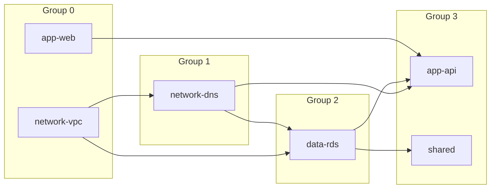

<sub>[Documentation](../README.md#documentation) › Dependencies</sub>

# Dependencies

Terramate stacks declare their order with `after` and `before` in the [stack configuration](https://terramate.io/docs/cli/stacks/configuration). This tool turns that order into Atlantis [`depends_on`](https://www.runatlantis.io/docs/repo-level-atlantis-yaml.html) (with `--depends-on`) and `execution_order_group` (with `--execution-order-groups`), so Atlantis plans and applies projects in the same order as `terramate run`.

```sh
terramate-atlantis-config generate --depends-on --execution-order-groups
```

**On this page:** [Example](#example) · [How `after` and `before` are resolved](#how-after-and-before-are-resolved) · [`depends_on`](#depends_on) · [Execution order groups](#execution-order-groups) · [Edge cases](#edge-cases)

## Example

In [`testdata/dependencies`](../testdata/dependencies), `stacks/app/api` runs after the DNS stack and every stack tagged `database`, and `stacks/app/web` declares `before = ["../api"]`:

<table>
<tr>
<th><code>stacks/app/api/stack.tm.hcl</code> (excerpt)</th>
<th>Generated project (excerpt)</th>
</tr>
<tr>
<td valign="top">

```hcl
stack {
  name  = "api"
  after = ["/stacks/network/dns", "tag:database"]
}
```

</td>
<td valign="top">

```yaml
  - name: app-api
    dir: stacks/app/api
    execution_order_group: 3
    depends_on:
      - app-web
      - data-rds
      - network-dns
```

</td>
</tr>
</table>

<p align="center"><sub><b>Figure 1.</b> A stack's ordering and the project settings generated from it.</sub></p>

The whole fixture produces this order. An arrow points from a project to the projects that depend on it:



<p align="center"><sub><b>Figure 2.</b> Dependencies and execution order groups generated for <code>testdata/dependencies</code>.</sub></p>

| Project       | Stack declares                                    | `execution_order_group` | `depends_on`                         |
| ------------- | ------------------------------------------------- | ----------------------- | ------------------------------------ |
| `network-vpc` | nothing                                           | `0` (key left out)      |                                      |
| `network-dns` | `after = ["../vpc"]`                              | `1`                     | `network-vpc`                        |
| `data-rds`    | `after = ["tag:network"]`                         | `2`                     | `network-dns`, `network-vpc`         |
| `app-web`     | `before = ["../api"]`                             | `0` (key left out)      |                                      |
| `app-api`     | `after = ["/stacks/network/dns", "tag:database"]` | `3`                     | `app-web`, `data-rds`, `network-dns` |
| `shared`      | `after = ["/stacks/data"]`                        | `3`                     | `data-rds`                           |

<p align="center"><sub><b>Table 1.</b> The same result as a table.</sub></p>

## How `after` and `before` are resolved

Entries have the same meaning as in `terramate run`:

| Entry                                       | Resolves to                                                                                      |
| ------------------------------------------- | ------------------------------------------------------------------------------------------------ |
| Relative path, such as `../vpc`             | the stack at that path and every stack below it                                                  |
| Absolute path, such as `/stacks/network/vpc` | the stack at that path and every stack below it                                                 |
| A directory that isn't a stack              | every stack below it                                                                             |
| A path that doesn't exist                   | nothing; the entry is ignored                                                                    |
| A tag query, such as `tag:network`          | every stack matching the [tag filter](https://terramate.io/docs/cli/reference/cmdline/run#--tags), and the stacks nested below them |

<p align="center"><sub><b>Table 2.</b> How each kind of <code>after</code> and <code>before</code> entry is resolved.</sub></p>

## `depends_on`

`depends_on` lists **project names**, because that is what Atlantis matches it against. So `--depends-on` requires `--create-project-name`, which is on by default. With `--create-project-name=false` it fails:

```text
Error: depends_on requires project names: Atlantis matches depends_on entries against project names, so --depends-on cannot be used with --create-project-name=false
```

## Execution order groups

A project's `execution_order_group` is the length of its longest chain of generated dependencies. A project with no dependencies gets `0`, which leaves the key out.

## Edge cases

<details>
<summary><b>Stacks that aren't generated</b></summary>

Stacks that aren't generated (filtered out, not changed, or skipped) aren't listed in `depends_on`. Ordering is still followed through them, as `terramate run` does: if `a` runs after `m` and `m` after `z`, `a` still depends on `z` when `m` isn't generated.

With `--exclude-path stacks/data`, the fixture above gives `shared` the dependencies of the excluded `data-rds` instead: `network-dns` and `network-vpc`.

</details>

<details>
<summary><b>Dependency cycles</b></summary>

Cycles are reported as a warning, and the stacks on a cycle share one execution order group:

```text
Warning: dependency cycle detected between stacks a, b; their order among themselves can't be honored, so they share an execution_order_group
```

With `--depends-on`, the warning says instead that Atlantis can't apply these projects until you break the cycle, since their `depends_on` entries reference each other.

</details>

<details>
<summary><b>Paths that don't exist</b></summary>

A path that doesn't exist is ignored, but the Terramate SDK logs a warning about it on stderr, such as `path /stacks/app/does-not-exist not found in configuration`. Hide it with `--log-level error`.

</details>
