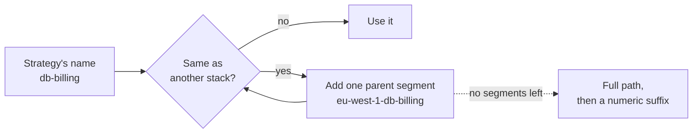

<sub>[Documentation](../README.md#documentation) › Project naming</sub>

# Project naming

Every project gets a name derived from its stack's path. The default strategy, `auto-strip`, drops the path prefix that all stacks share. Pick another strategy with `--project-name-strategy`, or turn names off with `--create-project-name=false`.

**On this page:** [Strategies](#strategies) · [Names are stable](#names-are-stable) · [Names are unique](#names-are-unique) · [Names are valid](#names-are-valid) · [Strip a prefix](#strip-a-prefix) · [Edge cases](#edge-cases)

## Strategies

Take a repository with these three stacks:

```text
stacks/
└── aws/
    ├── prod/
    │   └── eu-west-1/
    │       ├── db/billing/stack.tm.hcl
    │       └── vpc/stack.tm.hcl
    └── staging/
        └── eu-west-1/
            └── db/billing/stack.tm.hcl
```

<p align="center"><sub><b>Figure 1.</b> Example repository used on this page.</sub></p>

Each strategy names them like this:

| Strategy     | How it names a stack                                                         | `prod/…/db/billing`                    | `prod/…/vpc`                    | `staging/…/db/billing`                    |
| ------------ | ---------------------------------------------------------------------------- | -------------------------------------- | ------------------------------- | ----------------------------------------- |
| `auto-strip` | Strips the longest path prefix (whole segments) all stacks share             | `prod-eu-west-1-db-billing`            | `prod-eu-west-1-vpc`            | `staging-eu-west-1-db-billing`            |
| `stack-name` | Uses the stack's `name` (or its dir name), prefixed with up to 3 parent dirs | `prod-eu-west-1-db-billing`            | `aws-prod-eu-west-1-vpc`        | `staging-eu-west-1-db-billing`            |
| `last-n`     | Uses the last N path segments                                                | `prod-eu-west-1-db-billing`            | `eu-west-1-vpc`                 | `staging-eu-west-1-db-billing`            |
| `full`       | Full path, no stripping                                                      | `stacks-aws-prod-eu-west-1-db-billing` | `stacks-aws-prod-eu-west-1-vpc` | `stacks-aws-staging-eu-west-1-db-billing` |

<p align="center"><sub><b>Table 1.</b> Project names per strategy. <code>last-n</code> uses <code>--project-name-depth 2</code>; both billing stacks would be <code>db-billing</code>, so the tool made them <a href="#names-are-unique">unique</a>.</sub></p>

```sh
terramate-atlantis-config generate --project-name-strategy last-n --project-name-depth 2
```

## Names are stable

Names are always computed against every stack in the repository, except stacks with `atlantis_skip`. So `--changed`, `--filter`, `--filter-path` and `--exclude-*` never rename a project. A project keeps its name whether or not a given run includes it.

> [!WARNING]
> Adding or removing stacks can rename projects. With `auto-strip`, a repository whose only stack is `stacks/aws/production/vpc` names it `stacks-aws-production-vpc`. Add `stacks/aws/staging/vpc`, and the shared prefix becomes `stacks/aws`, so the first project becomes `production-vpc`. To keep names fixed, set [`--project-name-prefix`](#strip-a-prefix).

## Names are unique

If two stacks would get the same name, the tool adds parent segments to the name the strategy produced until they differ. As a last resort it falls back to the full path, then to a numeric suffix.



<p align="center"><sub><b>Figure 2.</b> How a name collision is resolved. Here both billing stacks clash until <code>prod-…</code> and <code>staging-…</code> tell them apart.</sub></p>

## Names are valid

`/` and characters Atlantis rejects in project names (anything that isn't URL safe, such as spaces) are replaced with `-`. Leading `-` are dropped.

## Strip a prefix

`--project-name-prefix` strips a path prefix you choose:

```sh
terramate-atlantis-config generate --project-name-prefix stacks/aws/prod
```

| Stack                                     | Name                                      |
| ----------------------------------------- | ----------------------------------------- |
| `stacks/aws/prod/eu-west-1/db/billing`    | `eu-west-1-db-billing`                    |
| `stacks/aws/prod/eu-west-1/vpc`           | `eu-west-1-vpc`                           |
| `stacks/aws/staging/eu-west-1/db/billing` | `stacks-aws-staging-eu-west-1-db-billing` |

<p align="center"><sub><b>Table 2.</b> Names with an explicit prefix. The staging stack isn't under the prefix, so it keeps its full path.</sub></p>

| Strategy     | What the prefix does                                       |
| ------------ | ---------------------------------------------------------- |
| `auto-strip` | Replaces the detected common prefix                        |
| `stack-name` | Is stripped before the strategy picks its parent dirs      |
| `last-n`     | Nothing: the prefix is ignored                             |
| `full`       | Nothing: the prefix is ignored                             |

<p align="center"><sub><b>Table 3.</b> How each strategy uses <code>--project-name-prefix</code>.</sub></p>

The prefix only strips whole path segments: `stacks/aws/prod` strips `stacks/aws/prod/vpc` but not `stacks/aws/production/vpc`.

## Edge cases

<details>
<summary><b>The root stack, workspaces, <code>depends_on</code> and sort order</b></summary>

- **A single stack** has nothing to share a prefix with, so `auto-strip` keeps its full path: a repository whose only stack is `stacks/aws/production/vpc` names it `stacks-aws-production-vpc`.
- **The root stack.** A stack at the repository root gets `dir: .` and the name `root`. With `stack-name`, it gets its `name` attribute, if set.
- **`depends_on` needs names.** [`--depends-on`](dependencies.md) fails with `--create-project-name=false`, because Atlantis matches `depends_on` entries against project names.
- **Workspaces.** `--create-workspace` sets each project's workspace from its stack path, changed where needed into a valid Atlantis workspace name (`infra/vpc` becomes `infra-vpc`). The root stack keeps the default workspace. Generated workflows don't pass the workspace to Terraform; see [Workflows](workflows.md#generated-workflow-details).
- **Sort order.** `--sort-by name` sorts projects by name instead of dir. `--sort-by execution_order_group` needs `--execution-order-groups`, otherwise it sorts by dir.

</details>
