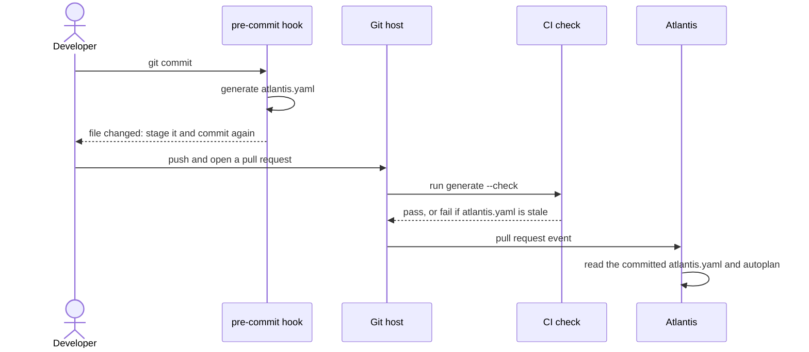
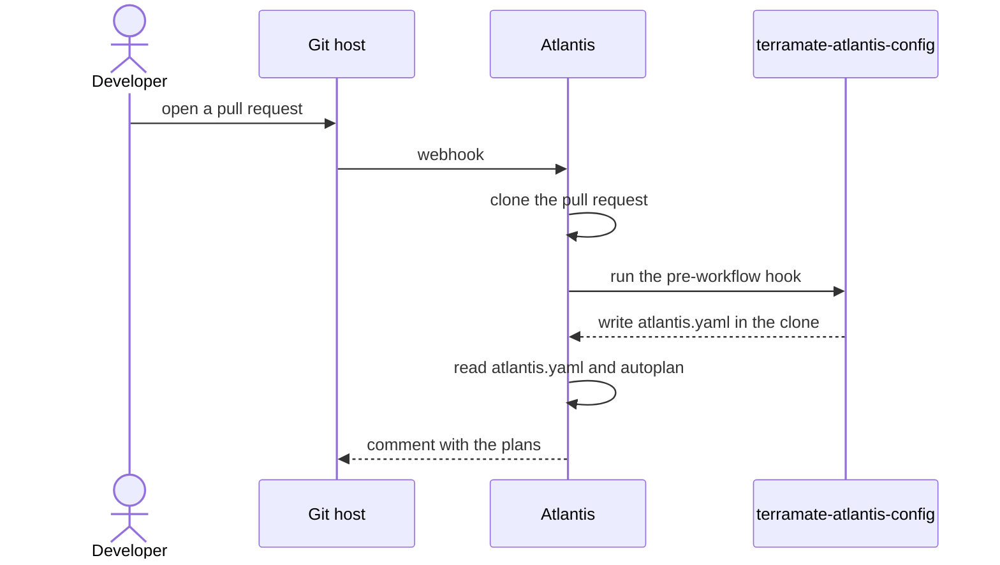

<sub>[Documentation](../README.md#documentation) › Setup</sub>

# Setup

You can produce `atlantis.yaml` in one of two places. In **setup A** you generate it and commit it, so every change to it shows up in review. In **setup B** the Atlantis server generates it for each pull request, so there is no generated file in git.

**On this page:** [A. Commit the file](#a-commit-the-file) · [pre-commit hook](#pre-commit-hook) · [GitHub Action](#github-action) · [Other CI systems](#other-ci-systems) · [B. Generate on the Atlantis server](#b-generate-on-the-atlantis-server) · [Server-side repo config](#server-side-repo-config) · [Details](#details)

## A. Commit the file

Generate the file once from the repository root and commit it:

```sh
terramate-atlantis-config generate --output atlantis.yaml
git add atlantis.yaml
```

To keep it current, regenerate it on every commit with the [pre-commit hook](#pre-commit-hook). To catch a stale file, run the [GitHub Action](#github-action) or `--check` in [another CI system](#other-ci-systems).



<p align="center"><sub><b>Figure 1.</b> Setup A: the file is generated on your machine, checked in CI and read by Atlantis.</sub></p>

### pre-commit hook

Add the hook to `.pre-commit-config.yaml`:

```yaml
repos:
  - repo: https://github.com/devops-roast/terramate-atlantis-config
    rev: v1
    hooks:
      - id: terramate-atlantis-config
```

The hook runs `terramate-atlantis-config generate --output atlantis.yaml` on every commit. pre-commit builds it from source (`language: golang`). If the file changes, pre-commit stops the commit: stage `atlantis.yaml` and commit again.

`rev: v1` follows the latest `v1.x.y` release. Pin a full tag such as `v1.2.2` for reproducible results.

<details>
<summary><b>Edge cases</b></summary>

- The hook writes `atlantis.yaml` at the repository root, even when the config file sets `output`. To write it elsewhere, pass `args: [--output, path/to/atlantis.yaml]`; the last `--output` wins.
- The hook runs on every commit, whatever files you staged. A stack can change through files of any type, and deleting a stack leaves no staged file for a file filter to match.
- Don't set `changed: true` in the config file. It would apply to the hook too, and the committed file would only list the stacks changed against the base ref. See [Filtering](filtering.md#changed-stacks).

</details>

### GitHub Action

This job fails when `atlantis.yaml` is missing or out of date:

```yaml
jobs:
  check-atlantis-config:
    runs-on: ubuntu-latest
    steps:
      - uses: actions/checkout@v7
      - uses: devops-roast/terramate-atlantis-config@v1
        id: atlantis
        with:
          root: "."
          output: atlantis.yaml
          check: "true"
      - run: echo "${{ steps.atlantis.outputs.projects }} projects"
```

Without `check: "true"`, the action writes the file instead, for example to commit it from a later step.

| Input     | Default         | Description                                                                                        |
| --------- | --------------- | -------------------------------------------------------------------------------------------------- |
| `version` | `latest`        | `latest`, a release tag such as `v1.1.0`, or any other git ref (built with `go install`, needs Go) |
| `root`    | `.`             | Root directory of the Terramate project                                                            |
| `output`  | `atlantis.yaml` | Output file path                                                                                   |
| `check`   | `false`         | Fail if the output file is missing or out of date                                                  |
| `args`    |                 | Extra whitespace-separated arguments for `generate` (quotes are not interpreted)                   |
| `token`   | `github.token`  | Token for downloading the release from github.com; `""` downloads anonymously                      |

<p align="center"><sub><b>Table 1.</b> GitHub Action inputs.</sub></p>

| Output     | Description                                                                              |
| ---------- | ---------------------------------------------------------------------------------------- |
| `projects` | Number of projects in the generated configuration (any mode; `0` if it can't be counted) |
| `version`  | Installed version                                                                        |

<p align="center"><sub><b>Table 2.</b> GitHub Action outputs.</sub></p>

`@v1` follows the latest `v1.x.y` release. Pin a full tag such as `@v1.1.0` for reproducible builds.

To see what changed when the check fails, add `--diff` through `args`:

```yaml
      - uses: devops-roast/terramate-atlantis-config@v1
        with:
          check: "true"
          args: --diff
```

<details>
<summary><b>How the action installs the tool</b></summary>

The action downloads the release binary for the runner (Linux, macOS or Windows; amd64 or arm64) and verifies it against the release's `checksums.txt`. On github.com it downloads through the GitHub API with the workflow's token, so it isn't subject to the limits and timeouts of anonymous downloads. On GitHub Enterprise Server, or without `jq` on the runner, it downloads anonymously. Failed requests are retried.

A `version` that isn't a release tag, such as `main`, is built with `go install`. Set up Go first with `actions/setup-go`.

</details>

### Other CI systems

Run the same command with `--check` and `--diff`:

```sh
terramate-atlantis-config generate --output atlantis.yaml --check --diff
```

When the file is current, it prints `atlantis.yaml is up to date` and exits `0`. Otherwise it prints the diff and exits `1`:

```diff
--- atlantis.yaml
+++ atlantis.yaml
@@ -13,14 +13,6 @@
         - '*.tf'
         - '*.tf.json'
         - .terraform.lock.hcl
-  - name: infra-rds
-    dir: infra/rds
-    autoplan:
-      enabled: true
-      when_modified:
-        - '*.tf'
-        - '*.tf.json'
-        - .terraform.lock.hcl
   - name: infra-vpc
     dir: infra/vpc
     autoplan:
```

<p align="center"><sub><b>Figure 2.</b> <code>--diff</code> output after removing the <code>infra/rds</code> stack from <code>testdata/multi</code>. On stderr, <code>--check</code> adds: <code>atlantis.yaml is out of date, run the same command without --check and --diff to update it</code>.</sub></p>

Pass the same flags you use to generate the file. The other flags shape the output too. See [CI modes](configuration.md#ci-modes) for the flags.

## B. Generate on the Atlantis server

Atlantis can generate `atlantis.yaml` itself, in a [pre-workflow hook](https://www.runatlantis.io/docs/pre-workflow-hooks.html) that runs before it reads the repo config. You need two things: the binary in your Atlantis image, and the hook in the server-side `repos.yaml`.



<p align="center"><sub><b>Figure 3.</b> Setup B: Atlantis generates the file in its own checkout of every pull request.</sub></p>

**Step 1. Add the binary to your Atlantis image.** This Dockerfile installs a release and verifies its checksum:

```dockerfile
FROM ghcr.io/runatlantis/atlantis:v0.49.0

ARG TAC_VERSION=1.2.2
ARG TARGETARCH=amd64

USER root
RUN set -eux; \
  base="https://github.com/devops-roast/terramate-atlantis-config/releases/download/v${TAC_VERSION}"; \
  archive="terramate-atlantis-config_${TAC_VERSION}_linux_${TARGETARCH}.tar.gz"; \
  cd /tmp; \
  curl -fsSLO "${base}/${archive}"; \
  curl -fsSLO "${base}/checksums.txt"; \
  grep " ${archive}\$" checksums.txt | sha256sum -c -; \
  tar -xzf "${archive}" -C /usr/local/bin terramate-atlantis-config; \
  rm -f "${archive}" checksums.txt
USER atlantis
```

**Step 2. Add the hook to the server-side `repos.yaml`:**

```yaml
repos:
  - id: /.*/
    pre_workflow_hooks:
      - run: terramate-atlantis-config generate --output atlantis.yaml --root .
        description: Generate atlantis.yaml from Terramate stacks
    # Only needed when the generated file uses these; see "Server-side repo config".
    allowed_overrides:
      - workflow
      - apply_requirements
    allow_custom_workflows: true
```

Atlantis now generates `atlantis.yaml` in its checkout of every pull request. There's no need to commit the file: the hook overwrites it.

**Step 3 (optional). Tune the output.** Commit a [`.terramate-atlantis.yaml`](configuration.md#config-file) to the repository. The hook reads it from the pull request's checkout, so a pull request can change it too.

> [!TIP]
> The end-to-end tests run this setup against a real Atlantis server. Use [`e2e/repos.yaml`](../e2e/repos.yaml) and [`e2e/Dockerfile.atlantis`](../e2e/Dockerfile.atlantis) as a working reference.

<details>
<summary><b>Edge cases</b></summary>

- `--root .` makes project dirs relative to the repository root that Atlantis checked out, which is what Atlantis expects.
- With [generated workflows](workflows.md), the image also needs the `terramate` CLI and a `terraform` binary on `PATH`. The [e2e image](../e2e/Dockerfile.atlantis) installs both.
- If you don't commit Terramate's generated code, a pull request that only changes a parent's globals or an imported file plans nothing by default. Run `terramate generate` in the hook too and turn on `--when-modified-from-config`. See [Generated code in Atlantis](autoplan.md#generated-code-in-atlantis).
- `--changed` needs the base branch in Atlantis' checkout, which the default `branch` checkout strategy doesn't fetch. See [`--changed` in shallow clones](#--changed-in-shallow-clones).

</details>

## Server-side repo config

Atlantis only accepts an `atlantis.yaml` whose keys the [server-side repo config](https://www.runatlantis.io/docs/server-side-repo-config.html) allows. If one project breaks the rule, Atlantis rejects the whole file. This applies to both setups.

| The generated file has…           | Because you used                                                              | The server needs                          |
| --------------------------------- | ----------------------------------------------------------------------------- | ----------------------------------------- |
| a `workflow` on a project         | `atlantis_workflow`, `--workflow`, `--tag-workflow` or `--generate-workflows` | `allowed_overrides: [workflow]`           |
| `apply_requirements` on a project | `atlantis_apply_requirements`, `--apply-requirements` or `--tag-requirements` | `allowed_overrides: [apply_requirements]` |
| a top-level `workflows` block     | `--generate-workflows`, the `workflows` config key or `--preserve-workflows`  | `allow_custom_workflows: true`            |

<p align="center"><sub><b>Table 3.</b> Server-side options each feature needs.</sub></p>

A file generated with the defaults uses none of these keys and needs no server-side changes. For the error messages Atlantis prints, see [Troubleshooting](troubleshooting.md#atlantis-rejects-atlantisyaml).

## Details

### `--changed` in shallow clones

[`--changed`](filtering.md#changed-stacks) compares against `--changed-base-ref`, so that ref must exist in the checkout. A shallow or single-branch clone doesn't have it. That is the default of `actions/checkout`, and of Atlantis' `branch` checkout strategy. The run then fails with `fatal: ambiguous argument 'main': unknown revision or path not in the working tree`.

In GitHub Actions, fetch the full history:

```yaml
      - uses: actions/checkout@v7
        with:
          fetch-depth: 0
```

In another shallow clone, fetch the history and the base branch before you run the tool:

```sh
git fetch --unshallow origin main:refs/remotes/origin/main
```

Then compare against the point where your branch left `main`:

```sh
terramate-atlantis-config generate --changed --changed-base-ref "$(git merge-base origin/main HEAD)" --output atlantis.yaml
```

> [!NOTE]
> Passing the merge base matters when `main` has moved on since you branched. `--changed` compares the base ref with `HEAD` directly, so with `--changed-base-ref origin/main` a stack changed only on `main` also counts as changed. See [Filtering](filtering.md#changed-stacks).
