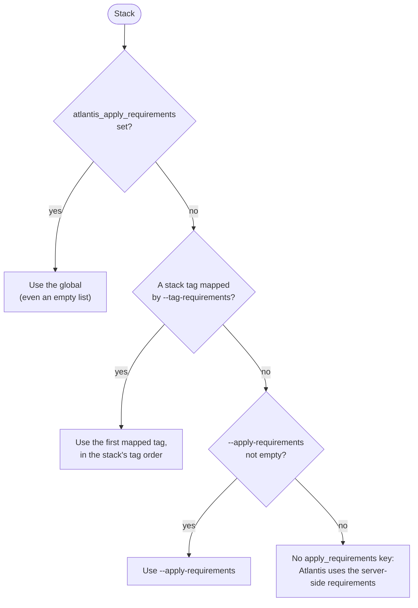

<sub>[Documentation](../README.md#documentation) › Stack globals</sub>

# Stack globals

Set `atlantis_*` [Terramate globals](https://terramate.io/docs/cli/code-generation/variables/globals) in a stack to override the defaults for that stack's project. Globals are inherited, so a global in a parent directory applies to every stack below it.

<table>
<tr>
<th><code>prod/stack.tm.hcl</code></th>
<th>Generated project</th>
</tr>
<tr>
<td valign="top">

```hcl
stack {
  name = "prod"
  id   = "a1b2c3d4-0000-0000-0000-000000000010"
}

globals {
  atlantis_workflow          = "production"
  atlantis_terraform_version = "1.5.0"
  atlantis_extra_deps        = ["../modules/**/*.tf"]
}
```

</td>
<td valign="top">

```yaml
projects:
  - name: prod
    dir: prod
    workflow: production
    terraform_version: 1.5.0
    autoplan:
      enabled: true
      when_modified:
        - '*.tf'
        - '*.tf.json'
        - .terraform.lock.hcl
        - ../modules/**/*.tf
```

</td>
</tr>
</table>

<p align="center"><sub><b>Figure 1.</b> Globals in <a href="../testdata/with_globals"><code>testdata/with_globals</code></a> and the project they produce.</sub></p>

A project with a `workflow` or `apply_requirements` needs the server to allow it. See [Server-side repo config](setup.md#server-side-repo-config).

## Globals

| Global                        | Type         | Description                                           | Overrides |
| ----------------------------- | ------------ | ----------------------------------------------------- | --------- |
| `atlantis_skip`               | bool         | Generate no project for this stack                    |           |
| `atlantis_workflow`           | string       | Override workflow for this stack                      | `--workflow`, `--tag-workflow` |
| `atlantis_autoplan`           | bool         | Override autoplan enabled/disabled                    | `--autoplan` |
| `atlantis_terraform_version`  | string       | Override Terraform version                            | `--terraform-version` |
| `atlantis_when_modified`      | list(string) | Override when_modified patterns, including the ones `--when-modified-from-config` adds | `--when-modified`, `--when-modified-from-config` |
| `atlantis_extra_deps`         | list(string) | Additional when_modified entries merged with defaults (ignored when `atlantis_when_modified` is set) | adds to `--when-modified` |
| `atlantis_apply_requirements` | list(string) | Override apply requirements                           | `--apply-requirements`, `--tag-requirements` |

<p align="center"><sub><b>Table 1.</b> Supported globals. Each flag also stands for its config file key.</sub></p>

For how the workflow is chosen when tags map to workflows too, see [Workflows](workflows.md#how-a-project-gets-its-workflow).

## Apply requirements

A project's `apply_requirements` come from the first source that is set:



<p align="center"><sub><b>Figure 2.</b> How a project's apply requirements are chosen.</sub></p>

When no source sets them, Atlantis falls back to the [server-side requirements](https://www.runatlantis.io/docs/command-requirements.html).

Repeat `--tag-requirements` for each tag:

```sh
terramate-atlantis-config generate \
  --tag-requirements production=approved,mergeable \
  --tag-requirements staging=mergeable
```

<details>
<summary><b>Edge cases</b></summary>

- **Empty lists are explicit.** `atlantis_when_modified = []` and `atlantis_apply_requirements = []` are overrides, not "unset". `apply_requirements: []` is written to the project, which tells Atlantis to require nothing before apply, overriding the server-side requirements as well. Leave the global unset to fall back to tag requirements, `--apply-requirements`, and then the server-side defaults.
- **An empty default only clears the default.** An empty `--apply-requirements` or `apply_requirements: []` in the config file leaves the `apply_requirements` key out of the project, so Atlantis uses the server-side requirements.
- **Null is unset.** A global set to `null` (for example from `cond ? [...] : null`) counts as unset.
- **Wrong types fail the run:**

  ```text
  Error: discovering stacks: extracting atlantis globals for stack "/prod": atlantis_autoplan must be bool
  ```

- **Unknown globals are ignored with a warning.** Any other global starting with `atlantis_`, usually a typo, prints a warning on stderr and changes nothing. The warning lists up to three stacks that see the global:

  ```text
  Warning: unknown global "atlantis_workflows" (stacks: prod) is ignored; known atlantis globals: atlantis_apply_requirements, atlantis_autoplan, atlantis_extra_deps, atlantis_skip, atlantis_terraform_version, atlantis_when_modified, atlantis_workflow
  ```

- **Only selected stacks are checked.** A stack that a [filter](filtering.md) leaves out can't fail the run through invalid globals. `atlantis_skip` doesn't excuse invalid globals on a stack the filters select.
- **Skipped stacks** don't take part in [project naming](project-naming.md), and [ordering](dependencies.md) is followed through them.
- `atlantis_terraform_version` doesn't change the `terraform` binary that a [generated workflow](workflows.md#generated-workflow-details) runs.

</details>
