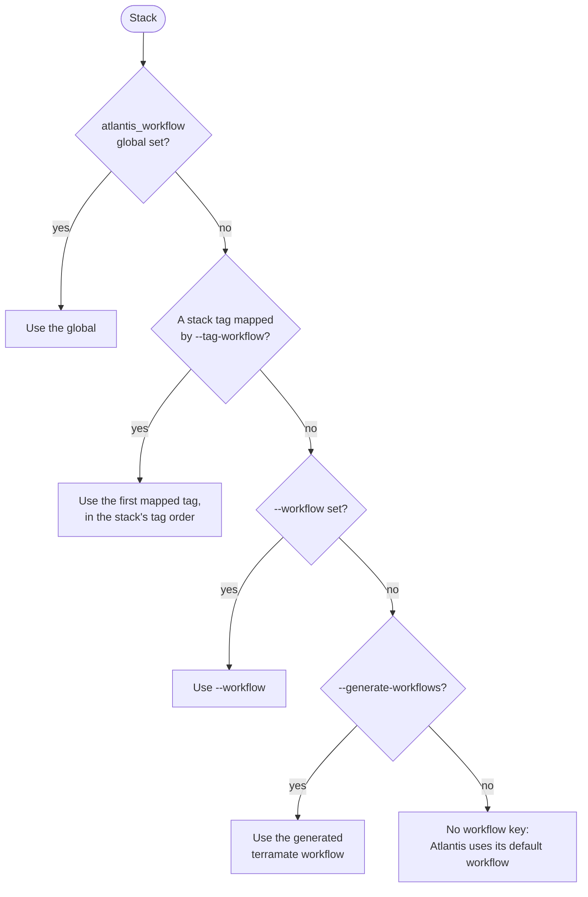
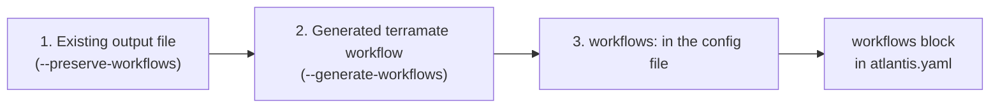

<sub>[Documentation](../README.md#documentation) › Workflows</sub>

# Workflows

An Atlantis [workflow](https://www.runatlantis.io/docs/custom-workflows.html) defines the commands Atlantis runs to plan and apply a project. This tool can assign a workflow to each project, and it can generate a `terramate` workflow that runs Terraform through [`terramate run`](https://terramate.io/docs/cli/reference/cmdline/run).

**On this page:** [Generate a workflow](#generate-a-workflow) · [How a project gets its workflow](#how-a-project-gets-its-workflow) · [Why the generated workflow uses these flags](#why-the-generated-workflow-uses-these-flags) · [Merging workflows](#merging-workflows) · [Generated workflow details](#generated-workflow-details)

## Generate a workflow

```sh
terramate-atlantis-config generate --generate-workflows --output atlantis.yaml
```

```yaml
version: 3
automerge: false
parallel_plan: true
parallel_apply: true
projects:
  - name: stack-a
    dir: stack-a
    workflow: terramate
    autoplan:
      enabled: true
      when_modified:
        - '*.tf'
        - '*.tf.json'
        - .terraform.lock.hcl
workflows:
  terramate:
    apply:
      steps:
        - run: terramate run --no-recursive --disable-safeguards=git -- terraform apply "$PLANFILE"
    plan:
      steps:
        - run: terramate run --no-recursive --disable-safeguards=git -- terraform init -input=false > /dev/null
        - run: terramate run --no-recursive --disable-safeguards=git -- terraform plan -input=false -out="$PLANFILE"
```

<p align="center"><sub><b>Figure 1.</b> Output for <a href="../testdata/simple"><code>testdata/simple</code></a> with <code>--generate-workflows --no-header</code>.</sub></p>

> [!IMPORTANT]
> Atlantis only accepts this file if the server-side config sets `allowed_overrides: [workflow]` and `allow_custom_workflows: true`. The Atlantis server also needs the `terramate` CLI and `terraform` on its `PATH`. See [Setup](setup.md#server-side-repo-config).

## How a project gets its workflow

Each project gets the first workflow that applies:



<p align="center"><sub><b>Figure 2.</b> Workflow selection order. Each flag also stands for its config file key.</sub></p>

Map tags to workflows with a comma-separated list, or repeat the flag:

```sh
terramate-atlantis-config generate --tag-workflow production=prod-wf,staging=staging-wf
```

`--tag-requirements` maps tags to apply requirements in the same order; see [Apply requirements](stack-globals.md#apply-requirements).

## Why the generated workflow uses these flags

<dl>
<dt><code>--no-recursive</code></dt>
<dd>Every stack is its own Atlantis project, so a parent stack must not also run its nested child stacks.</dd>
<dt><code>--disable-safeguards=git</code></dt>
<dd>Atlantis plans pull requests whose branch is usually behind the default branch. That makes Terramate's <code>git-out-of-sync</code> <a href="https://terramate.io/docs/cli/orchestration/safeguards">safeguard</a> refuse to run (<code>current HEAD is out-of-date with the remote base branch</code>). Terramate skips the <code>git-untracked</code> and <code>git-uncommitted</code> checks under <code>--no-recursive</code>, so disabling all of <code>git</code> changes nothing else. <code>outdated-code</code> stays enabled.</dd>
<dt><code>&gt; /dev/null</code> on <code>terraform init</code></dt>
<dd>Atlantis posts a run step's output in a <code>diff</code> block, and GitHub shows each line that starts with <code>-</code> in red, so the <code>- Installing ...</code> lines of a successful <code>init</code> look like errors. The redirect drops only <code>init</code>'s stdout: Terraform writes errors to stderr, so a failed <code>init</code> still shows them, unlike with <code>output: hide</code>.</dd>
</dl>

Pick a different set of safeguards to disable with `--workflow-disable-safeguards`:

| Keyword           | Disables                                                     |
| ----------------- | ------------------------------------------------------------ |
| `git`             | `git-untracked`, `git-uncommitted` and `git-out-of-sync` (the default) |
| `git-untracked`   | the check for untracked files                                |
| `git-uncommitted` | the check for uncommitted changes                            |
| `git-out-of-sync` | the check that `HEAD` is up to date with the remote base branch |
| `outdated-code`   | the check that generated code is up to date                  |
| `all`             | every safeguard above                                        |
| `none`            | nothing: re-enables every safeguard; can't be combined with `all` |

<p align="center"><sub><b>Table 1.</b> Keywords accepted by <code>--workflow-disable-safeguards</code>, as defined by <a href="https://terramate.io/docs/cli/orchestration/safeguards">Terramate</a>.</sub></p>

```sh
# Disable only these two
terramate-atlantis-config generate --generate-workflows --workflow-disable-safeguards git-out-of-sync,git-untracked

# Keep every safeguard
terramate-atlantis-config generate --generate-workflows --workflow-disable-safeguards=
```

`--workflow-terramate-wrap=false` runs plain `terraform` commands instead of wrapping them in `terramate run`.

> [!TIP]
> If you write your own workflows that call `terramate run`, add the same flags, or set this environment variable on the Atlantis server:
>
> ```sh
> TM_DISABLE_SAFEGUARDS=git
> ```

## Merging workflows

The `workflows` block can come from three sources. They are merged by name, and a later source replaces a workflow of the same name from an earlier one:



<p align="center"><sub><b>Figure 3.</b> Workflow sources, from lowest to highest precedence.</sub></p>

1. Workflows kept from the existing output file with `--preserve-workflows`.
2. The generated `terramate` workflow (`--generate-workflows`), so a stale copy in the existing file is refreshed.
3. Workflows defined under `workflows:` in the [config file](configuration.md#config-file), so you can replace the generated workflow by defining one with the same name.

When a config file workflow replaces a generated one, or a different copy kept from the output file, a warning names it on stderr. Replacing an identical copy that the previous run wrote, or refreshing the generated workflow, is silent.

`--preserve-workflows` has no effect when writing to stdout.

## Generated workflow details

<dl>
<dt>Workspaces</dt>
<dd>Atlantis passes a project's workspace to run steps as <code>$WORKSPACE</code>, not <code>TF_WORKSPACE</code>. So with <code>--create-workspace</code>, the generated workflow still runs in Terraform's <code>default</code> workspace.</dd>
<dt>Terraform version</dt>
<dd>The generated workflow runs the <code>terraform</code> found on the Atlantis server's <code>PATH</code>. Atlantis installs the versions that projects ask for as <code>terraform&lt;version&gt;</code> and only uses them for its built-in steps. So a project's <code>terraform_version</code> (<code>--terraform-version</code>, <code>atlantis_terraform_version</code>) doesn't change the binary a generated workflow runs.</dd>
</dl>
